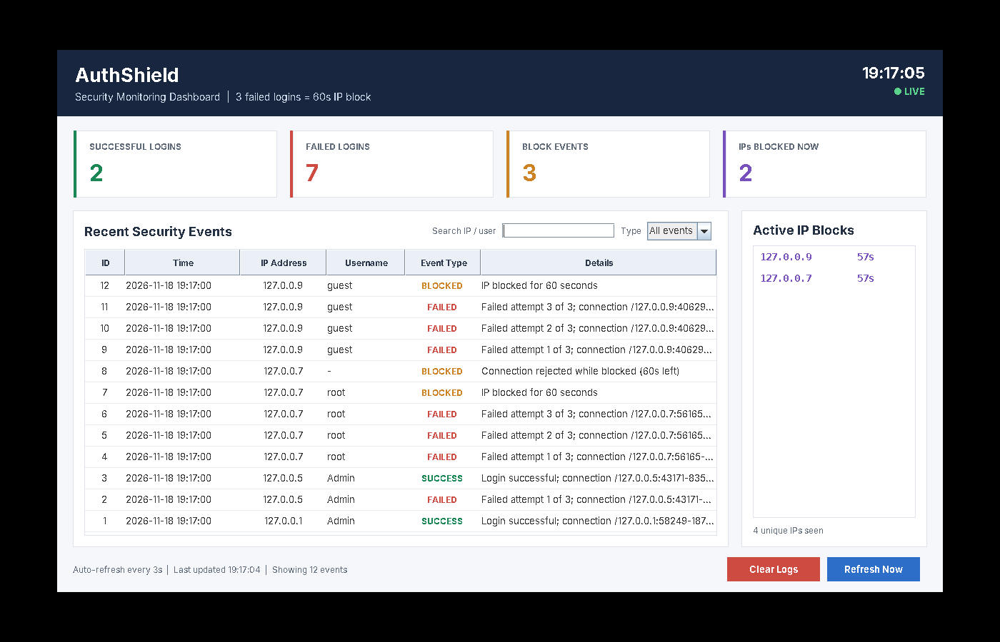
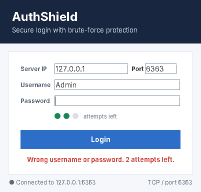
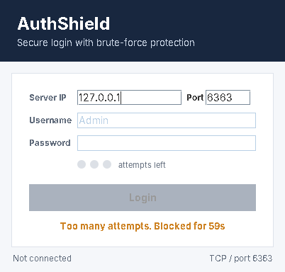

# AuthShield

**EC5205 Network Programming project.** AuthShield is a multi-client TCP
authentication server written in Java. It detects brute-force login
attacks: after **3 failed attempts an IP address is blocked for 60 seconds**.
Every security event is stored in SQLite and shown live on a Swing dashboard.



| Login client (failed attempts) | Login client (IP blocked) |
|---|---|
|  |  |

## Features

- TCP server (`ServerSocket`, port **6363**) handling many clients at once with a fixed thread pool (`ExecutorService`, 10 workers)
- Simple text application protocol (see below)
- Brute-force detection per **client IP**: reconnecting does not reset the counter
- Idle clients are disconnected after 120 s (`setSoTimeout`)
- SQLite event log (`security_events` table) written with prepared statements
- Swing **login client** with server IP field, attempts indicator and block countdown
- Swing **security dashboard**: live counters, active IP blocks with countdown, event table with search and type filter, clear logs
- Console client kept for quick testing

## Architecture

```
 AuthClientGUI / Authclient            AuthServer (port 6363)
 ─────────────────────────     TCP     ───────────────────────────────
  Socket ── LOGIN user pass ──────────►  accept() ─► thread pool ─► ClientHandler
         ◄─ SUCCESS / FAILED / BLOCKED ─                              │
                                                                     ▼
                                                               AuthService
                                                     (attempts per IP, 60 s block)
                                                                     │
 SecurityDashboard ◄──── reads every 3 s ──── authshield.db ◄── EventStore
```

| File | Role |
|---|---|
| `AuthServer.java` | Opens the server socket, accepts clients, hands each one to the thread pool |
| `ClientHandler.java` | One client per worker thread: reads requests, sends replies |
| `Protocol.java` | Protocol message names and helpers shared by server and clients |
| `AuthService.java` | Credential check and brute-force detection (thread-safe) |
| `EventStore.java` | SQLite access: log events, counts, active blocks |
| `SecurityDashboard.java` | Monitoring GUI |
| `AuthClientGUI.java` | Login GUI client |
| `Authclient.java` | Console client |

## Protocol

Plain text over TCP, one message per line (UTF-8).

| Direction | Message | Meaning |
|---|---|---|
| S → C | `WELCOME AuthShield` | Sent right after connecting |
| C → S | `LOGIN <username> <password>` | Login attempt |
| S → C | `SUCCESS <message>` | Correct credentials, connection closed |
| S → C | `FAILED <attemptsLeft>` | Wrong credentials, client may retry |
| S → C | `BLOCKED <secondsLeft>` | IP is blocked, connection closed |
| S → C | `ERROR <reason>` | Malformed request |
| C → S | `QUIT` | Client leaves, server replies `BYE` |

If a blocked IP connects again, the server sends `BLOCKED <secondsLeft>`
instead of `WELCOME` and closes the connection.

Demo credentials: **`Admin` / `1234`**

## How to run

Requires JDK 17+. The SQLite driver is included in `lib/`.

**Eclipse:** import the folder as an existing project. Run `AuthServer`,
then `SecurityDashboard`, then `AuthClientGUI` (Run As → Java Application).
Run all of them from the project folder so they share `authshield.db`.

**IntelliJ IDEA:** open the folder, add `lib/sqlite-jdbc-3.53.4.0.jar` as a
library (File → Project Structure → Libraries), then run the same classes.

**Command line (Windows):**

```bat
scripts\build.bat
scripts\run-server.bat
scripts\run-dashboard.bat
scripts\run-client-gui.bat 192.168.x.x
```

Linux/macOS: use the matching `scripts/*.sh` files.

## Demo on two laptops

1. On the server laptop, run the server and the dashboard. The server prints its IP address.
2. Both laptops on the same Wi-Fi. Allow Java through the Windows firewall if asked.
3. On the second laptop, run the GUI client and type the server IP.
4. Log in with `Admin` / `1234`: dashboard shows a **SUCCESS**.
5. Enter a wrong password 3 times: the client shows a 60 s countdown, the dashboard lists the IP under **Active IP Blocks**.
6. Close and reopen the client during the block: the server still refuses it (per-IP blocking).

## Limitations / future work

- One hard-coded user, plaintext password (future: users table with salted hashes such as bcrypt)
- No encryption on the wire (future: TLS with `SSLServerSocket`)
- Block state is kept in memory, so it resets when the server restarts
- Clients behind the same NAT share one public IP and therefore one block
